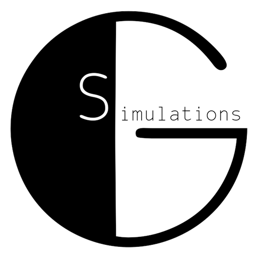
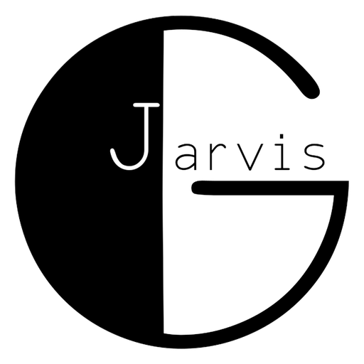

<h1 align="center">GSimulations für Home Assistant</h1>

Drei eigenständige Apps von <a href="https://www.gsimulations.de/">G-Simulation</a> für Home Assistant – jede einzeln installierbar. 
<i>Three independent Home Assistant apps by G-Simulation – install each one on its own.</i>

<a href="#deutsch">🇩🇪 Deutsch</a> · <a href="#english">🇬🇧 English</a>

<table align="center">
<tr>
<td align="center" valign="top" width="200"> <b><a href="#glighter">GLighter</a></b> Lärmprotokoll</td>
<td align="center" valign="top" width="200"> <b><a href="#greport">GReport</a></b> Notizen</td>
<td align="center" valign="top" width="200"> <b><a href="#gjarvis">GJarvis</a></b> Sprachassistent</td>
</tr>
</table>

---

## Installation

Voraussetzung: Home Assistant OS oder Supervised (mit App-Store).

1. Repository hinzufügen – per Klick: 
    
   oder von Hand: **Einstellungen → Apps → App-Store → ⋮ → Repositories** → `https://github.com/G-Simulation/GSimulations-HomeAssistant`
2. Im App-Store erscheinen unter **GSimulations** alle drei Apps. Die gewünschte App öffnen → **Installieren** → **Starten**.
3. Die App in der Seitenleiste öffnen.

Jede App läuft für sich. Du kannst eine, zwei oder alle drei installieren. Updates erscheinen automatisch in Home Assistant.

---

##  GLighter – Lärmprotokoll

Misst Lärm rund um die Uhr und protokolliert Störungen manipulationssicher – **ohne Tonaufnahme, ohne Cloud**.

- **Misst rund um die Uhr** mit einem USB-Mikrofon am Home-Assistant-Rechner und erkennt Störungen automatisch – mit Uhrzeit, Dauer und Spitzenpegel.
- **Speichert keinen Ton**, nur Messwerte. Sprache wird nie in Text umgewandelt.
- **Protokolle** für Tag, Woche, Monat oder frei gewählten Zeitraum, mit Tagesverlauf, Ruhezeiten und Statistik.
- **Lärmprotokoll zum Drucken oder als PDF** – für Vermieter, Hausverwaltung oder Anwalt.
- **Prüfkette:** Jede Minute bekommt eine SHA-256-Prüfsumme, nachträgliche Änderungen fallen auf.
- **Lokale Geräusch-Erkennung (KI)**, eigene Tonprofile, Regeln mit Home Assistant.

| | Kostenlos | GLighter Pro |
|---|:---:|:---:|
| Aufzeichnung, Live, Protokolle, Notizen | ✔ | ✔ |
| Lärmprotokoll, Druck, Export, Sicherung erstellen | ✔ | ✔ |
| Import einer Sicherung | einmal (Umzug) | ✔ |
| Erweiterte Einstellungen, eigene Statistiken | ansehen / Vorlagen | ✔ |
| Tägliche Sicherung auf NAS/USB | ZIP von Hand | ✔ |
| Externe Geräte (Handy, Stream, IP-Kamera) | – | ✔ |

**GLighter Pro:** Jahreslizenz für 1 Home-Assistant-Installation, **kein Abo** – [gsimulations.de/gaslighter](https://www.gsimulations.de/gaslighter/#buypro)

[Handbuch](docs/de/README.md) · [Schnellstart](docs/de/01-schnellstart.md) · [Fehlerbehebung](docs/de/13-fehlerbehebung.md) · [Rechtliches](docs/de/12-rechtliches.md) · [Änderungen](gaslighter/CHANGELOG.md)

---

##  GReport – Notizen zu Störungen

Hält Störungen als Notiz fest – schnell, mit Uhrzeit, Zeuge und Zeitraum. **Eigenständige App**, braucht kein GLighter.

- **Notiz jetzt:** einfach lostippen oder eine Taste der Schnellwahl antippen, Zeuge und Zeitraum dazu, Enter speichert.
- **Schnellwahl anpassen:** eigene Tasten anlegen, eingebaute ausblenden, Gruppen mit Farben und Pflicht-Gruppen.
- **Eigene Dashboard-Karte „GReport“:** wird automatisch eingerichtet und steht unter „Karte hinzufügen“ – Notiz, Woher, Was, Wie stark, Folgen, Maßnahmen, Zeuge und Speichern in einer Karte. Funktioniert für alle Benutzer, auch ohne Administratorrechte.
- **Bereich „GReport“:** Alle GReport-Felder stehen in Home Assistant gesammelt unter einem eigenen Bereich.
- **Home Assistant:** jede Notiz im Logbuch, Sensoren „Letzte Notiz“ und „Notizen heute“ (MQTT/Mosquitto).
- Ist zusätzlich GLighter installiert, erscheinen die Notizen mit GLighter Pro automatisch auch dort.

| | Kostenlos | GReport Pro |
|---|:---:|:---:|
| Notiz jetzt, Schnellwahl, Zeitraum, Liste, Suche | ✔ | ✔ |
| Dashboard-Karte „GReport“, Bereich „GReport“, Logbuch, Sensoren | ✔ | ✔ |
| Sicherung als ZIP herunterladen | ✔ | ✔ |
| Eigene Tasten in der Schnellwahl | 5 | bis 200 |
| Mehrere Zeugen pro Notiz | – | ✔ |
| Tagebuch als Textdatei (Text/CSV, auf Wunsch pro Monat) | – | ✔ |
| Export und Import (Text, CSV, JSON) | – | ✔ |
| Tägliche Sicherung (14 Tage) | – | ✔ |

**GReport Pro:** Jahreslizenz, **kein Abo** – ein GLighter-Pro-Schlüssel gilt auch. [gsimulations.de/greport](https://www.gsimulations.de/greport/)

[Mehr zu GReport](greport/README.md) · [Änderungen](greport/CHANGELOG.md)

---

##  GJarvis – Sprachassistent

Deutscher Sprachassistent für Home Assistant – „wie im Film“: **„Hey Jarvis“ → „Ja?“ → Befehl.** Eigenständige App.

| | Kostenlos | GJarvis Pro |
|---|:---:|:---:|
| „Hey Jarvis“ und alles, was dein Home-Assistant-Agent kann (Licht, Geräte, Listen, Satz-Automationen, deine KI) | ✔ | ✔ |
| Oberfläche in der Seitenleiste, Kalibrierung, Lautstärke, Stimme | ✔ | ✔ |
| Entitäten „hört“ / „spricht“, Ereignis `gjarvis_command` | ✔ | ✔ |
| Nachfragen ohne Weckwort, Unterbrechen mit „Hey Jarvis“ | – | ✔ |
| Timer, Erinnerungen, Wecker, Gedächtnis | – | ✔ |
| Morgen-Briefing (Wetter, Kalender, Erinnerungen, Nachrichten) | – | ✔ |
| Ansagen aus Automationen mit Gong und Ruhezeit | – | ✔ |
| Wetter und Flugwetter, Internet-Recherche | – | ✔ |
| Eigenes KI-Modell (Ollama oder OpenAI-kompatibel) mit eigener Persönlichkeit | – | ✔ |

**GJarvis Pro:** Jahreslizenz, **kein Abo** – [gsimulations.de/gjarvis](https://www.gsimulations.de/gjarvis/#buypro)

Voraussetzungen: die Apps **Whisper**, **Piper** und **Mosquitto**.

[Mehr zu GJarvis](gjarvis/README.md) · [Änderungen](gjarvis/CHANGELOG.md)

---

## Datenschutz und Hilfe

Alle Daten bleiben auf deinem Home-Assistant-Rechner; keine der Apps sendet etwas an G-Simulation oder Dritte. Details: [PRIVACY.md](PRIVACY.md).

Fehler melden oder Idee vorschlagen: [Issues](https://github.com/G-Simulation/GSimulations-HomeAssistant/issues/new/choose) · Kontakt: [gsimulations.de](https://www.gsimulations.de/)

---

## English

Three independent Home Assistant apps by G-Simulation. Add the repository once and install any of them:

 
or manually: **Settings → Apps → App store → ⋮ → Repositories** → `https://github.com/G-Simulation/GSimulations-HomeAssistant`

| App | What it does |
|---|---|
| &nbsp**GLighter** | Noise log – measures noise 24/7 and logs disturbances tamper-evident. No audio recording, no cloud. Printable noise report. [Manual](docs/en/README.md) |
| &nbsp**GReport** | Disturbance notes – note, quick select, witness, time span. Own dashboard card "GReport" for all users. Works on its own. |
| &nbsp**GJarvis** | German voice assistant "Hey Jarvis". Pro: timers, reminders, memory, briefing, weather, web search. Needs Whisper, Piper and Mosquitto. |

All data stays on your Home Assistant computer. [Privacy](PRIVACY.md) · [Issues](https://github.com/G-Simulation/GSimulations-HomeAssistant/issues/new/choose) · [gsimulations.de](https://www.gsimulations.de/)

---

© G-Simulation (Patrick Gottberg). Alle Rechte vorbehalten / All rights reserved – siehe [LICENSE](LICENSE). Fremde Bestandteile / third-party components: [NOTICE.md](NOTICE.md).
