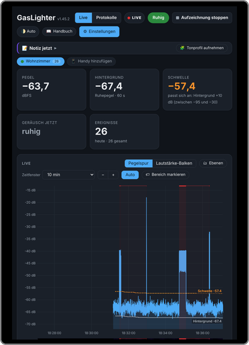
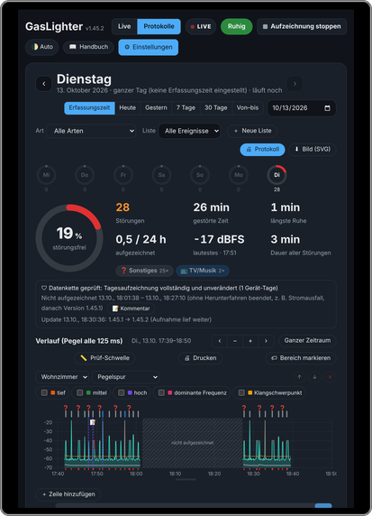
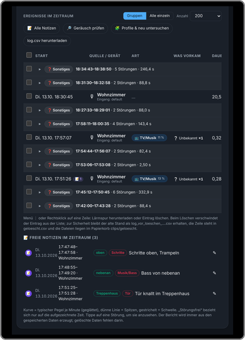
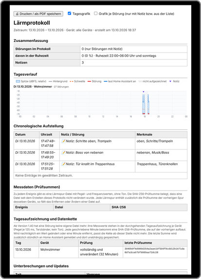

<b>Lärmprotokoll für Home Assistant</b> – misst Lärm rund um die Uhr und protokolliert Störungen manipulationssicher. Ohne Tonaufnahme, ohne Cloud. 
<i>Noise log for Home Assistant – measures noise 24/7 and logs disturbances tamper-evident. No audio recording, no cloud.</i>

<a href="#english">🇬🇧 English</a> · <a href="#deutsch">🇩🇪 Deutsch</a> · <a href="docs/de/README.md">Handbuch</a> · <a href="docs/en/README.md">Manual</a> · <a href="https://www.gsimulations.de/gaslighter/">gsimulations.de/gaslighter</a>

---

## Deutsch

### Was GasLighter macht

- **Misst rund um die Uhr** mit einem Mikrofon am Home-Assistant-Rechner und erkennt Störungen automatisch – mit Uhrzeit, Dauer und Spitzenpegel. Die Schwelle passt sich dem normalen Hintergrund der Wohnung an.
- **Speichert keinen Ton**, sondern nur Messwerte (Pegel, Frequenzbild, Zeitpunkte). Sprache wird nie in Text umgewandelt.
- **Notizen** per Schlagwort („oben“, „Schritte“, „Musik/Bass“) oder Freitext, mit Zeugen und Maßnahmen.
- **Protokolle** für Tag, Woche, Monat oder frei gewählten Zeitraum, mit Tagesverlauf, Ruhezeiten und Statistik.
- **Lärmprotokoll zum Drucken oder als PDF** – für Vermieter, Hausverwaltung oder Anwalt.
- **Prüfkette**: Jede Minute der Aufzeichnung bekommt eine SHA-256-Prüfsumme, die auf der vorherigen aufbaut. Nachträgliche Änderungen fallen auf; die letzte Summe wird zusätzlich in Home Assistant gespeichert.
- **Lokale Geräusch-Erkennung (KI)**, eigene Tonprofile, Regeln mit Home Assistant (z. B. eigener Fernseher an), Unterbrechungen werden dokumentiert.
- **Sprache:** Oberfläche, Handbuch und Lärmprotokoll auf Deutsch oder Englisch (automatisch nach Browser oder fest einstellbar).
- **Handbuch** in der App (Deutsch/Englisch, mit Suche) – auch [hier auf GitHub](docs/de/README.md).

### Kostenlos und Pro

| | Kostenlos | GasLighter Pro |
|---|:---:|:---:|
| Aufzeichnung, Live, Protokolle, Notizen | ✔ | ✔ |
| Lärmprotokoll, Druck, Export (`log.csv`), Sicherung erstellen | ✔ | ✔ |
| Import einer Sicherung | einmal (Umzug) | ✔ |
| Erweiterte Einstellungen der Erkennung, 🎯 Schwelle automatisch einstellen | ansehen | ✔ |
| 📊 Eigene Statistiken selbst einstellen | Vorlagen | ✔ |
| Tägliche Sicherung auf Netzlaufwerk/NAS/USB, Platz sparen | ZIP von Hand | ✔ |
| Externe Geräte (Handy, Stream, IP-Kamera) | – | ✔ |

**GasLighter Pro** ist eine Jahreslizenz für 1 Home-Assistant-Installation, **kein Abo**. Der Schlüssel wird in der App ohne Internet geprüft. [Mehr und kaufen](https://www.gsimulations.de/gaslighter/#buypro) · [Handbuch: GasLighter Pro](docs/de/14-pro.md)

### Installation

Voraussetzung: Home Assistant OS oder Supervised (mit App-Store) und ein USB-Mikrofon am Home-Assistant-Rechner.

1. Repository hinzufügen – per Klick: 
    
   oder von Hand: **Einstellungen → Apps → App-Store → ⋮ → Repositories** → `https://github.com/G-Simulation/GasLighter`
2. **GasLighter** im App-Store öffnen → **Installieren** → **Starten**. Optional „Beim Start starten“ und „Watchdog“ einschalten.
3. **GasLighter** in der Seitenleiste öffnen. Der [Schnellstart](docs/de/01-schnellstart.md) führt durch die ersten fünf Minuten.

Updates erscheinen automatisch in Home Assistant. Änderungen: [CHANGELOG](gaslighter/CHANGELOG.md).

### Beta (Testversion)

Im selben Repository steht zusätzlich **GasLighter Beta** – die Arbeitsversion mit den neuesten Änderungen, bevor sie freigegeben werden. Sie läuft **neben** dem normalen GasLighter (eigener Datenordner `/share/gaslighter_beta`, eigene Entitäten, Handy-Port 18444) und kann Fehler enthalten. Für den Alltag den normalen GasLighter verwenden.

Soll die Beta mit **denselben Daten** arbeiten (Datenordner `/share/gaslighter`), immer nur **eine** der beiden Apps laufen lassen. Ab Version 1.64 schützt eine Sperre davor: Läuft die andere schon, nimmt die zweite nichts auf und zeigt einen Hinweis.

### Datenschutz und Recht

Alle Daten bleiben auf deinem Home-Assistant-Rechner; GasLighter sendet nichts an G-Simulation oder Dritte. Details: [PRIVACY.md](PRIVACY.md). GasLighter ersetzt keine Rechtsberatung – ob ein Lärmprotokoll in deinem Fall ausreicht, klärst du am besten mit Mieterverein oder Anwalt. Siehe auch das Kapitel [Rechtliches](docs/de/12-rechtliches.md).

### Hilfe

- [Handbuch](docs/de/README.md) und [Fehlerbehebung](docs/de/13-fehlerbehebung.md)
- Fehler melden oder Idee vorschlagen: [Issues](https://github.com/G-Simulation/GasLighter/issues/new/choose)
- Kontakt: [gsimulations.de/gaslighter](https://www.gsimulations.de/gaslighter/#getInTouch-gl)

---

## English

### What GasLighter does

- **Measures 24/7** with a microphone on the Home Assistant computer and detects disturbances automatically – with time, duration and peak level. The threshold adapts to the normal background of your home.
- **Stores no audio**, only measurements (level, frequency picture, timestamps). Speech is never converted to text.
- **Notes** with tags ("upstairs", "footsteps", "music/bass") or free text, with witnesses and actions taken.
- **Reports** for a day, week, month or any period, with daily chart, quiet hours and statistics.
- **Printable noise report / PDF** – for landlord, property management or lawyer.
- **Checksum chain**: every minute of recording gets a SHA-256 checksum built on the previous one. Later changes become visible; the latest checksum is also stored in Home Assistant.
- **Local sound recognition (AI)**, your own sound profiles, Home Assistant rules (e.g. your own TV on), interruptions are documented.
- **Language:** interface, manual and noise report in English or German (automatic from the browser or set in Settings → General → Language).
- **Manual** in the app (German/English, searchable) – also [here on GitHub](docs/en/README.md).

### Free and Pro

| | Free | GasLighter Pro |
|---|:---:|:---:|
| Recording, live view, reports, notes | ✔ | ✔ |
| Noise report, printing, export (`log.csv`), creating backups | ✔ | ✔ |
| Import a backup | once (moving) | ✔ |
| Advanced detection settings, 🎯 set threshold automatically | view | ✔ |
| 📊 Configure your own statistics | templates | ✔ |
| Daily backup to network drive/NAS/USB, save space | ZIP by hand | ✔ |
| External devices (phone, stream, IP camera) | – | ✔ |

**GasLighter Pro** is a yearly licence for 1 Home Assistant installation, **no subscription**. The key is checked in the app without internet. [Learn more and buy](https://www.gsimulations.de/gaslighter/#buypro) · [Manual: GasLighter Pro](docs/en/14-pro.md)

### Installation

Requirements: Home Assistant OS or Supervised (with app store) and a USB microphone on the Home Assistant computer.

1. Add the repository – one click: 
    
   or manually: **Settings → Apps → App store → ⋮ → Repositories** → `https://github.com/G-Simulation/GasLighter`
2. Open **GasLighter** in the app store → **Install** → **Start**. Optionally enable "Start on boot" and "Watchdog".
3. Open **GasLighter** in the sidebar. The [quick start](docs/en/01-schnellstart.md) guides you through the first five minutes.

### Beta (test version)

The same repository also contains **GasLighter Beta** – the work-in-progress version with the latest changes before release. It runs **next to** the normal GasLighter (own data folder `/share/gaslighter_beta`, own entities, phone port 18444) and may contain bugs. Use the normal GasLighter for everyday use.

If the beta should use **the same data** (data folder `/share/gaslighter`), only ever run **one** of the two apps. From version 1.64 a lock protects against this: if the other one is already running, the second records nothing and shows a notice.

### Privacy and legal

All data stays on your Home Assistant computer; GasLighter sends nothing to G-Simulation or third parties. Details: [PRIVACY.md](PRIVACY.md). GasLighter is not legal advice.

### Help

[Manual](docs/en/README.md) · [Troubleshooting](docs/en/13-fehlerbehebung.md) · [Issues](https://github.com/G-Simulation/GasLighter/issues/new/choose) · [Contact](https://www.gsimulations.de/gaslighter/#getInTouch-gl)

---

© G-Simulation (Patrick Gottberg). Alle Rechte vorbehalten / All rights reserved – siehe [LICENSE](LICENSE). Fremde Bestandteile / third-party components: [NOTICE.md](NOTICE.md).
