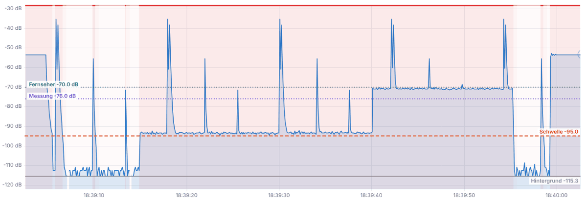
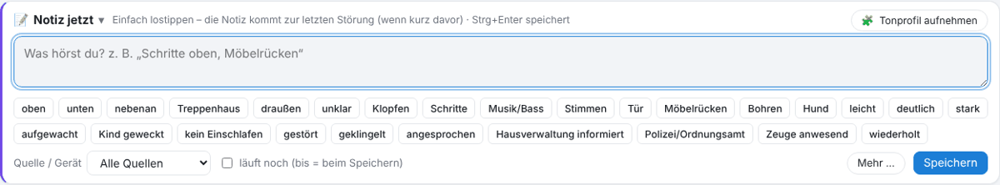
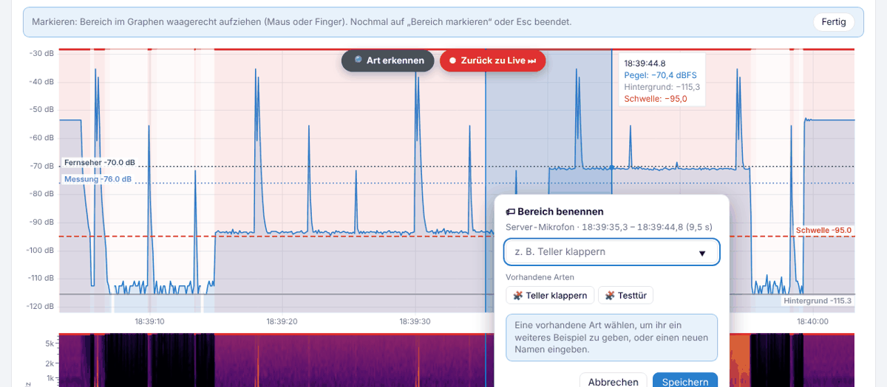

# Live-Ansicht

Der Reiter **Live** zeigt, was gerade passiert: Kacheln mit den aktuellen Werten, die Grafik der letzten Minuten, das Spektrogramm und die Ereignisse von heute.

## Kopfzeile

| Element | Bedeutung |
|---|---|
| **LIVE** | Die Anzeige folgt der Gegenwart. Nach dem Zurückspulen hier wieder zurück zu Live. |
| **Ruhig / STÖRUNG** | Zustand des gewählten Geräts. Rot = gerade über der Schwelle. Außerhalb der Überwachungszeit lässt sich hier „trotzdem erfassen“ einschalten. |
| **Aufzeichnung stoppen** | Hält die Aufzeichnung an (wird in `aufzeichnung.csv` festgehalten). Am Handy im Menü ⋯. |
| **🌓 Auto / ☀ / 🌙** | Hell, dunkel oder wie Home Assistant. |
| **⚙ Einstellungen** | Alle Einstellungen, siehe [Einstellungen](11-einstellungen.md). |

## Geräteleiste und Kacheln

Die Leiste unter der Notiz zeigt alle Geräte mit Anzahl der Störungen heute. Antippen wählt das Gerät. Sind mehrere Geräte live, wechselt die Ansicht im **Rundlauf** automatisch (Dauer über ⚙ in der Leiste).

- **Pegel** – aktueller Spitzenpegel.
- **Hintergrund** – der gelernte „normale“ Pegel.
- **Schwelle** – ab hier zählt es als Störung; darunter steht, wie sie berechnet wird.
- **Geräusch jetzt** – was die KI gerade hört (nur mit eingeschalteter Geräuscherkennung).
- **Ereignisse** – Störungen heute und insgesamt.

## Die Grafik

- **Blaue Fläche** = Pegel, **graue Linie** = Hintergrund, **orange gestrichelt** = Schwelle, **rot** = Störung, gepunktete farbige Linien = eigene Referenzlinien (z. B. „Fernseher −70 dB“).
- **Pegelspur / Lautstärke-Balken** schaltet die Darstellung um.
- **🗂 Ebenen** blendet Kurven ein und aus: Hintergrund, Schwelle, tief/mittel/hoch, dominante Frequenz, Klangschwerpunkt.
- **Zeitfenster** und **− / +** ändern die gezeigte Zeit; **Auto** passt die Höhe an.
- Darunter das **Spektrogramm**: Frequenz über Zeit, hell = laut. Tiefe Geräusche (Bass, Trittschall) liegen unten, Stimmen und Geschirr weiter oben.

### Bedienung

| Am Computer | Am Handy / Tablet |
|---|---|
| Strg + Mausrad oder Touchpad spreizen = Zeit zoomen (Mausrad allein scrollt die Seite; einstellbar unter ⚙ → Allgemein → „Mausrad im Diagramm“) | zwei Finger spreizen = Zeit zoomen |
| Ziehen oder seitlich wischen = in der Zeit blättern | waagerecht wischen = blättern, senkrecht = Seite scrollen |
| Umschalt + Ziehen = Bereich aufziehen und hineinzoomen | − / + |
| Umschalt + Mausrad oder Strg + Mausrad über der dB-Beschriftung = Höhe zoomen (unten bündig) | „Auto“ |
| Doppelklick = zurück zu Live | Doppeltippen = zurück zu Live |
| Über eine Störung fahren = Einzelheiten | Störung antippen = Einzelheiten |

**Mit der Tastatur:** Mit Tab auf die Grafik gehen (blauer Rahmen). Dann **+ / −** Zeit zoomen, **← / →** in der Zeit blättern, **↑ / ↓** Höhe, **0** zurücksetzen, **Ende** zurück zu Live. Screenreader lesen den aktuellen Pegel, die Schwelle und den Zustand vor.

Weiter zurück als die letzten 10 Minuten zeigt die Grafik den **ganzen Tag** aus der Tagesaufzeichnung (Zeitfenster 1 h, 6 h oder „Heute“).

## 📝 Notiz jetzt

Für das, was du gerade hörst – einfach lostippen oder Merkmale antippen (oben, unten, Klopfen, Bass, aufgewacht …).

- **Ohne eigene Uhrzeit**: Liegt kurz vorher eine Störung (Einstellung „Notiz zuordnen“, Standard 5 min), gilt die Notiz für sie. Die Leiste zeigt vorher, wohin sie kommt.
- **läuft noch**: Die Notiz bekommt einen Zeitraum von der ersten Eingabe bis zum Speichern.
- **Von / bis und Zeuge** stehen immer direkt im Bereich; leer lassen heißt „automatisch“ (Uhrzeit beim Speichern).
- **Nur Markierungen, kein Text?** Dann bildet GLighter beim Speichern einen Satz daraus, z. B. „Deutliche Schritte im Treppenhaus“. Du kannst ihn später ändern.

### Eigene Schnellwahl

- **＋ Eigene** am Ende der Tasten: Namen eingeben (z. B. „Waschmaschine“, „Nachbar 2. OG“) → **Anlegen**. Die Taste (★) gibt es dann in allen Notiz-Feldern, auch abgedockt, und im Filter der Notizen.
- **Rechtsklick oder lange drücken** auf eine Taste öffnet „Schnellwahl verwalten“: eigene **umbenennen** oder **löschen**, eingebaute **aus- und wieder einblenden**. Alte Notizen behalten ihre Bezeichnung.
- **Lernen:** Tippst du ein Wort öfter selbst (ab 3×), schlägt GLighter es als Taste vor (💡). Angelegt wird sie nur, wenn du **＋** drückst; **✕** heißt „nicht mehr vorschlagen“.
- **Reihenfolge:** Was du am häufigsten drückst, steht vorne – am Handy sind das die ersten 6.
- Die eigenen Tasten liegen in `clips/schnellwahl.json` und sind in der Sicherung (ZIP) enthalten.

**Abdocken (Pro):** Mit **⧉** neben dem Titel löst du den Notizbereich als eigenes kleines Fenster heraus. In Chrome und Edge bleibt es über anderen Programmen liegen (z. B. über einem Spiel oder Film), sonst ist es ein normales Zusatzfenster. **Zurückholen** oder das Fenster schließen setzt ihn wieder ein.
- <kbd>Strg</kbd> + <kbd>Enter</kbd> speichert. Am Handy ist die Leiste zunächst zugeklappt.

## 🏷 Bereich markieren

1. „🏷 Bereich markieren“ antippen – über der Grafik erscheint ein Hinweis mit **Fertig**.
2. Den Bereich waagerecht aufziehen (0,15 s bis 2 min).
3. Eine **vorhandene Art** antippen (Tonprofil 🧩 oder benannter Bereich 🏷) oder einen neuen Namen eingeben – gleicher Name = gleiche Art, die KI lernt daraus. Siehe [KI](05-ki.md#lernen).

## Ereignisse heute

Die Liste unten zeigt alle Störungen des Tages (alle Geräte oder das gewählte). Ein Klick öffnet die Störung, siehe [Ereignis-Fenster](04-ereignis.md). Spalten wählst du über ⚙. Am Handy erscheinen die Einträge als Karten.

**Nur sichtbarer Bereich** (Standard: an): Die Tabelle zeigt nur, was im Graphen darüber gerade zu sehen ist. Sie läuft live mit und folgt dem Zoomen und Verschieben. Aus: alle Ereignisse ab dem Anfang des Graphen.

**Spaltenbreiten:** Ziehst du eine Spalte am Rand im Kopf breiter oder schmaler, merkt sich GLighter die Breite (auf dem Server, für alle Browser gleich). Zurücksetzen über **▦ Layout anpassen** → **＋ Bereich hinzufügen** → **Spaltenbreiten der Tabellen zurücksetzen**.

## Anordnen und eigene Kacheln

Auch die Live-Ansicht besteht aus Bereichen (Notiz, Live-Bild, Ereignisse). Mit **▦ Layout anpassen** verschiebst du sie, änderst die Breite, benennst sie um oder blendest sie aus – mit der Maus, mit **↑ / ↓** (auch am Handy) oder mit der Tastatur. **📊 ＋ Kachel** legt eine Kachel an, z. B. „Störungen heute“ als große Zahl. Alles dazu unter [Protokolle → Layout anpassen](03-protokolle.md#designer) und [Kacheln](03-protokolle.md#statistik).

---
[← Schnellstart in 5 Minuten](01-schnellstart.md) · [Inhalt](README.md) · [Protokolle →](03-protokolle.md)
