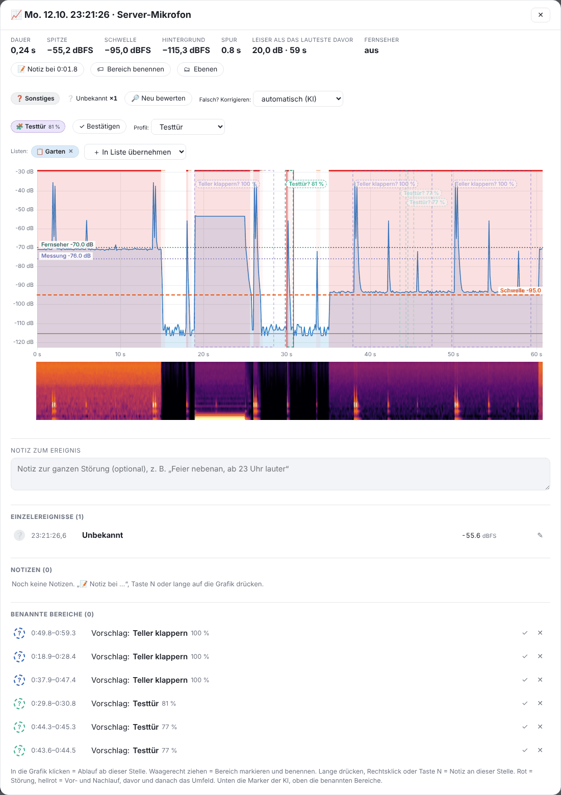

# Ereignis-Fenster

Ein Doppelklick auf eine Störung öffnet alle Einzelheiten.

## Kopfzahlen

Dauer, Spitze, Schwelle, Hintergrund, Spur (gezeigter Zeitraum) und:

- **Über dem Lautesten davor** bzw. **Leiser als das Lauteste davor** – Abstand der Spitze zum lautesten Pegel der Zeit davor (Störungen nicht mitgezählt). Belegt, dass die Störung lauter war als z. B. ein laufender Fernseher.
- Zustände aus Home Assistant (z. B. „Fernseher: aus“, Lautstärke), siehe [Home Assistant](07-home-assistant.md).

## Grafik

- **Rot** = die Störung, **rote Linien** = Beginn und Ende, hellrot = Vor- und Nachlauf.
- **Gestrichelte Kästen** = Vorschläge der App aus deinen Tonprofilen („Teller klappern? 100 %“). Vorschläge außerhalb der Störung sind blasser. Antippen: ✓ Stimmt / ✕ Stimmt nicht.
- Darunter das **Spektrogramm**; bei mehreren Geräten der **Vergleich der Geräte** (Spitze je Gerät, Abstand zum lautesten).
- **▶ Ablauf zeigen** lässt einen Zeiger in Echtzeit darüber laufen (ohne Ton).

## Art, Profil und Listen

- **Art (KI)** mit Sicherheit in %. „Falsch? Korrigieren“ setzt die Art von Hand – deine Korrektur hat Vorrang. **🔎 Neu bewerten** wertet erneut aus (braucht den gespeicherten KI-Fingerabdruck).
- **🧩 Profil**: das ähnlichste eigene Tonprofil. **✓ Bestätigen** oder ein anderes wählen – beides wird ein neues Lernbeispiel.
- **Listen**: Störung einer Protokollliste zuordnen oder entfernen.

## Notizen und benannte Bereiche

- **📝 Notiz bei …** (oder Taste <kbd>N</kbd>, langes Drücken auf die Grafik) legt eine Notiz an genau dieser Stelle an, mit Schnell-Merkmalen und Zeuge.
- **🏷 Bereich benennen**: in der Grafik waagerecht ziehen und einen Namen wählen. Siehe [KI → Lernen](05-ki.md#lernen).
- **Notiz zum Ereignis**: ein freies Textfeld je Störung, wird automatisch gespeichert.

---
[← Protokolle](03-protokolle.md) · [Inhalt](README.md) · [KI: Geräuscharten und Tonprofile →](05-ki.md)
