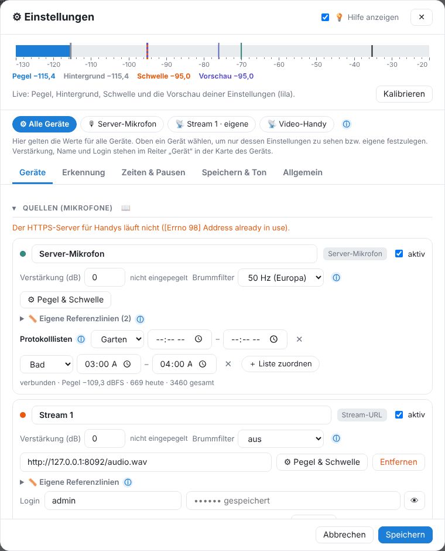

# Geräte

Unter ⚙ Einstellungen → **Geräte** → Quellen stehen alle Mikrofone. Bis zu 9 Geräte sind möglich.

## Server-Mikrofon

Das Mikrofon am Home-Assistant-Rechner. Unter **Mikrofon** wählst du Eingang, Buchse und Lautstärke. Meist „Standard“ lassen. **Brummfilter** (50 Hz in Europa) entfernt Netzbrummen.

## Handy als Mikrofon

> **🔒 Pro:** Handys, Stream-URLs und IP-Kameras sind externe Geräte und gehören zu [GasLighter Pro](14-pro.md). Das Server-Mikrofon ist immer frei.

- **Handy (Browser)**: „+ Handy (Browser)“, QR-Code scannen, Seite in Chrome öffnen, Zertifikatswarnung bestätigen, **Start**. Der Bildschirm muss an bleiben (Ladegerät). Der Link ist geheim und gehört nur zu diesem Handy.
- **Stream (z. B. App „IP Webcam“)**: „+ Handy-App / Stream-URL“, Adresse `http://HANDY-IP:8080/audio.wav`. Läuft auch mit ausgeschaltetem Bildschirm. Mit Login: Benutzername und Passwort in die eigenen Felder.
- Der Handy-Port ist standardmäßig **18443** (Add-on → Netzwerk, „8443/tcp“).

### Video

Bei Streams lässt sich **🎥 Video aufnehmen** einschalten: Bei einer Störung entsteht eine mp4-Datei **ohne Ton**. Ohne Störung wird nichts gespeichert. Qualität und Speicherort unter Speichern & Ton → Video & Speicherort.

> Kameraaufnahmen in Wohnungen können nach § 201a StGB problematisch sein – nur eigene Räume, keine fremden Personen filmen.

## Geräte-Karte

- **Name**, **aktiv**, **Verstärkung (dB)** und Brummfilter.
- **⚙ Pegel & Schwelle**: eigene Einstellungen nur für dieses Gerät.
- **📏 Eigene Referenzlinien**: z. B. „Fernseher −70 dB“, erscheinen in allen Grafiken dieses Geräts.
- **Protokolllisten**: Störungen dieses Geräts automatisch einer Liste zuordnen, auf Wunsch nur zu bestimmten Uhrzeiten.
- Aus einer [Sicherung](09-sicherung.md) übernommene Geräte, die nicht erreichbar waren, sind ausgeschaltet und tragen den Hinweis „bitte prüfen“.

## Geräte einpegeln

Damit Pegel verschiedener Geräte vergleichbar sind:

1. Alle Mikrofone nebeneinander legen.
2. **Geräte einpegeln** → mitmessende Geräte anhaken (mindestens zwei) → Start.
3. 5 s Ruhe, dann ein gleichmäßiges Geräusch (z. B. Rauschen aus einem Handy-Lautsprecher, mindestens 10 dB lauter).

Jedes Gerät bekommt eine eigene Verstärkung, sodass alle beim selben Geräusch denselben Wert zeigen. Jede Messung wird festgehalten und erscheint im Lärmprotokoll. Ändert sich die Verstärkung später von Hand, steht beim Gerät „⚠ seit dem Einpegeln geändert“.

## Mehrere Räume vergleichen

Löst ein Gerät aus, speichern alle anderen für denselben Zeitraum mit („Bei einer Störung alle Geräte mitspeichern“). Im Ereignis-Fenster zeigt **Vergleich der Geräte** die Spitze je Gerät. Ein Fernseher im Wohnzimmer ist dort am lautesten und hat viele Höhen; Klopfen über Decke und Wände ist in allen Räumen ähnlich und tief.

---
[← KI: Geräuscharten und Tonprofile](05-ki.md) · [Inhalt](README.md) · [Home Assistant →](07-home-assistant.md)
