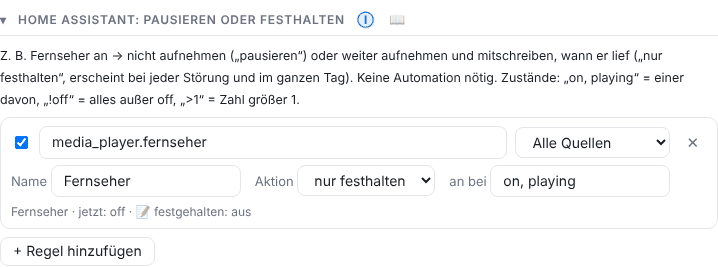

# Home Assistant

GasLighter arbeitet mit Home Assistant zusammen: Regeln fragen Zustände ab (Fernseher an, Waschmaschine läuft, Sensor ausgelöst), und über MQTT meldet die App Störungen, Prüfsummen und Schalter zurück.

<a id="regeln"></a>

## Regeln: pausieren oder festhalten



⚙ Einstellungen → Zeiten & Pausen → **Home Assistant: pausieren oder festhalten** → **Regel hinzufügen**.

| Feld | Bedeutung |
|---|---|
| Entität | z. B. `media_player.fernseher`, `binary_sensor.vibration_wand` |
| Gerät | für welches Mikrofon die Regel gilt (oder alle) |
| **Name** | Unter diesem Namen wird die Regel festgehalten, z. B. „Erschütterung Wand“. Leer = Name aus Home Assistant. |
| Aktion | **nur festhalten** (weiter aufnehmen und mitschreiben, z. B. eigener Fernseher), **als Ereignis** (wie festhalten, zusätzlich eigene Zeile in der Ereignistabelle, z. B. Tür- oder Vibrationssensor) oder **pausieren** (in dieser Zeit nicht aufnehmen) |
| an bei / pausieren bei | `on, playing` = einer davon, `!off` = alles außer off, `>1` = Zahl größer 1 |
| Nachlauf, höchstens | nur bei „pausieren“: so lange danach weiter pausieren, Höchstdauer |

„jetzt: …“ zeigt live, was Home Assistant meldet – so siehst du, welchen Zustand ein Gerät wirklich hat. Im Zweifel wird aufgenommen.

**Festhalten** schreibt jeden Wechsel in `ha_zustand.csv`. An jeder Störung steht dann z. B. „Fernseher: an · 🔊 18 %“, im Verlauf erscheint oben ein **schmaler blauer Streifen** (je Sensor eine eigene Spur), und das Lärmprotokoll nennt den Zustand. Nur **pausieren** färbt die ganze Höhe (dort wurde nicht ausgewertet).

**Als Ereignis** zeichnet je Sensor ein farbiges Fähnchen und eine rote Linie über die ganze Höhe. Die Farbe wählst du in der Regel unter **Farbe** (↺ = automatisch). Jedes „an“ steht unter **📡 Sensor-Ereignisse** in der Ereignistabelle – mit Uhrzeit, Dauer und Notiz (✎). Sensor-Ereignisse zählen **nicht** als Störung und werden getrennt gezählt. Die Umstellung gilt auch rückwirkend, weil die Zustände schon in `ha_zustand.csv` stehen.

**Notiz zum Zeitraum:** Klick auf den Streifen (oder ✎ in der Liste) öffnet ein Fenster für eine Notiz, z. B. „eigener Film geschaut“. Sie steht im Streifen, in der Liste und im Lärmprotokoll.

**Filter „📡 Sensoren“** (Protokolle, oben): Mehrfachauswahl, welche Sensoren, Handy-Erschütterung/-Bewegung und ob Störungen gezeigt werden. Gilt für Verlauf, Listen und Tabelle. Meldet der Fernseher seine Lautstärke, wird sie mitgeschrieben.

> Bereits Festgehaltenes behält seinen Namen, auch wenn du ihn später änderst.

<a id="zigbee"></a>

## Zigbee-Sensoren (Vibration, Bewegung, Tür)

Sensoren, die in Home Assistant eingebunden sind (z. B. über Zigbee2MQTT oder ZHA), funktionieren genauso:

1. Regel hinzufügen, Entität des Sensors wählen (z. B. `binary_sensor.vibration_decke_occupancy`).
2. Name eingeben, z. B. „Erschütterung Decke“.
3. Aktion **als Ereignis** (oder **nur festhalten**), „an bei“ `on`.

Ab dann steht bei jeder Störung, ob gleichzeitig eine Erschütterung gemeldet wurde – ein starker Hinweis auf Trittschall oder Klopfen über das Gebäude.

<a id="mqtt"></a>

## MQTT: Steuern und Melden

Ist MQTT eingerichtet, erscheint in Home Assistant das Gerät **GasLighter** mit:

- Schalter **Aufzeichnung**, **Manuell erfassen (außerhalb der Zeit)**, Zahl **Pause (Minuten)**, Tasten **Pause 15 min**, **Pause 1 h**, **Fortsetzen**, Sensor **Pause bis**.
- Je Gerät: Ereignis **Störung (Auslöser)** (beginn, ende, erkannt – mit Spitze, Dauer, Art, Profil), Geräte-Auslöser für Automationen, Sensor „Letzte Geräuschart“ und stündlich die aktuelle **Prüfsumme** (in Home Assistant unabhängig gespeichert).

Beispiel – 10 Minuten Pause, wenn die Katzentoilette reinigt:

```yaml
automation:
  - alias: "GasLighter pausieren, wenn das Katzenklo reinigt"
    trigger:
      - platform: state
        entity_id: sensor.katzenklo_status
        to: "cleaning"
    action:
      - service: mqtt.publish
        data:
          topic: gaslighter/pause/set
          payload: '{"minutes": 10, "reason": "Katzenklo"}'
```

Eine von Hand gestoppte Aufzeichnung wird durch eine Pause aus Home Assistant nicht automatisch wieder gestartet.

## Störung direkt im Dashboard erfassen

Mit MQTT meldet das Add-on zwei Elemente am Gerät „GasLighter“:

- **Störung / Notiz erfassen**: Textfeld. Text eingeben, Enter drücken, schon ist die Notiz mit der aktuellen Uhrzeit gespeichert. Das Feld leert sich danach.
- **Störung jetzt markieren**: Knopf. Ein Tipp legt sofort eine Notiz „Störung (Home Assistant)“ an, ohne Text.

Beide legst du auf ein beliebiges Dashboard (z. B. als Karte „Entitäten“). Liegt kurz davor eine Störung, wird die Notiz ihr zugeordnet, genau wie bei der Notizleiste im Live-Bild.

## Keine Störung melden (Graph läuft weiter)

Manchmal soll eine Störung nicht gemeldet werden, der Graph aber trotzdem weiterlaufen, zum Beispiel wenn du selbst die Tür öffnest.

- **In einer Regel:** Wähle bei der Aktion **„keine Störung melden“**. Solange die Bedingung gilt und für den **Nachlauf** (z. B. 10 Minuten), entsteht keine Störung. Der Graph wird weiter aufgezeichnet, es gibt keine Lücke.
- **Als Knopf im Dashboard:** Am Gerät „GasLighter“ gibt es **„Keine Störung melden (Dauer starten)“**, **„Störungen wieder melden“**, die einstellbare **Dauer** (1–240 Minuten, Standard 10) und **„Keine Störungsmeldung bis“**. Lege sie auf dein Dashboard. Ein Tipp auf den Knopf startet die eingestellte Dauer.

---
[← Geräte](06-geraete.md) · [Inhalt](README.md) · [Drucken und Lärmprotokoll →](08-drucken.md)
