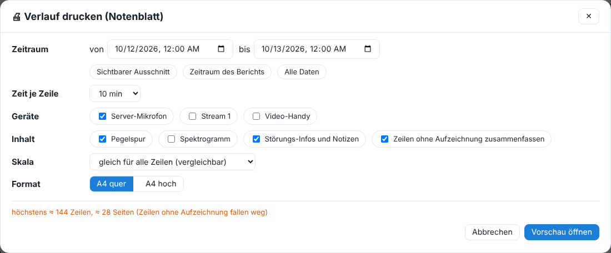
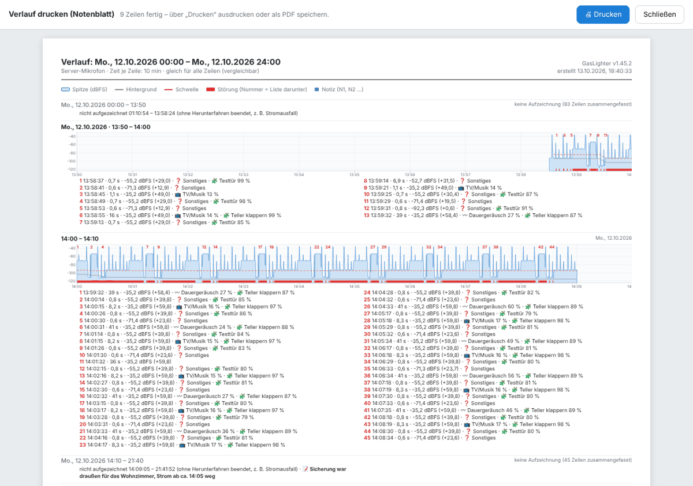

# Drucken und Lärmprotokoll

Es gibt zwei Ausdrucke: das **Lärmprotokoll** (Bericht mit Zusammenfassung und Liste) und den **Verlauf als Notenblatt** (die Kurven Zeile für Zeile).

## Lärmprotokoll

Reiter Protokolle → **🖨 Protokoll** (für Zeitraum, Gerät und Liste) oder **📝 Alle Notizen** → Protokoll. Es enthält:

- Zeitraum, Geräte, Zusammenfassung (Anzahl, gestörte Zeit, längste Ruhe), erkannte Geräuscharten, benannte Bereiche,
- den **Tagesverlauf**: je Tag und Gerät eine Grafik über 24 h (Spitze, Hintergrund, Schwelle, Störungen rot, Home Assistant blau, nicht aufgezeichnet schraffiert, Notizen), gleiche Skala je Gerät,
- jede Störung mit Datum, Uhrzeit, Dauer, Pegel, Art, Notizen, Zeugen und Zuständen aus Home Assistant,
- Ruhezeiten (🌙), Gegenmaßnahmen, Einpegeln der Geräte,
- **Unterbrechungen und Updates** mit Ursache und deinem Kommentar,
- die **Datenkette** je Gerät und Tag mit Prüfsumme.

Oben auf der Seite (wird nicht mitgedruckt) wählst du **Tagesgrafik** (Standard an) und **Grafik je Störung** (Standard aus): eine kleine Grafik mit Umfeld unter jeder Störung, die eine Notiz hat oder aus der gewählten Liste stammt (höchstens 300).

Im Browser drucken oder als PDF speichern. Das ausgedruckte Dokument heißt immer „Lärmprotokoll“.

> Pegel sind relative dBFS-Werte, keine geeichte Messung in dB(A). Tonaufnahmen kommen nie ins Protokoll. Keine Rechtsberatung.

## Verlauf drucken (Notenblatt)

Im Verlauf **🖨 Drucken**:

- **Zeitraum**: von–bis oder Schnellwahl „Sichtbarer Ausschnitt“, „Zeitraum des Berichts“, „Alle Daten“.
- **Zeit je Zeile**: 1 min bis 1 h (Standard 10 min – ein ganzer Tag sind 144 Zeilen).
- **Geräte** untereinander, **Inhalt** (Pegelspur, Spektrogramm, Störungs-Infos und Notizen), **Zeilen ohne Aufzeichnung zusammenfassen** (Standard an).
- **Skala**: gleich für alle Zeilen (vergleichbar) oder je Zeile angepasst (mehr Einzelheiten); **A4 quer** oder **hoch**.

Der Dialog schätzt Zeilen und Seiten. **Vorschau öffnen** baut die Seiten in einem neuen Fenster auf; dort **Drucken** oder als PDF speichern. Eine aktive [Prüf-Schwelle](03-protokolle.md#pruefschwelle) wird mitgedruckt, mit Zählung je Zeile.

---
[← Home Assistant](07-home-assistant.md) · [Inhalt](README.md) · [Sicherung, Import und Export →](09-sicherung.md)
