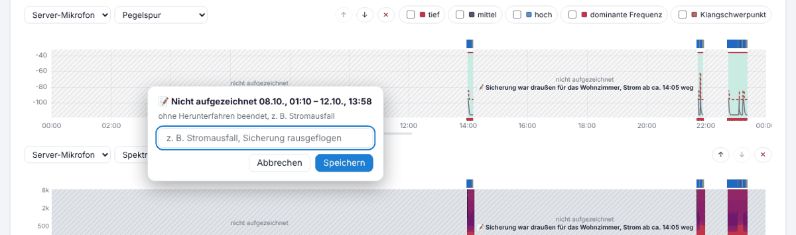

# Unterbrechungen, Datenkette und Updates

## Unterbrechungen

Läuft das Add-on nicht (Stromausfall, Home Assistant neu gestartet, Update über den Add-on-Store), fehlt die Aufnahme. GasLighter merkt sich das beim nächsten Start und zeigt es in Protokolle unter der Zusammenfassung:

- **ohne Herunterfahren beendet, z. B. Stromausfall** – das Add-on konnte sich nicht abmelden (Strom weg, Absturz).
- **von Home Assistant angehalten / neu gestartet** – sauber beendet (Neustart, Add-on gestoppt).
- **Update** – neue Fassung installiert.

Nach einem Stromausfall startet Home Assistant das Add-on von selbst, sobald der Rechner wieder läuft.

## Kommentar setzen

- Im **Verlauf** auf die schraffierte Fläche klicken bzw. tippen – ein kleines Fenster mit Zeitraum und Ursache öffnet sich. Text eingeben, z. B. „Sicherung rausgeflogen“, **Speichern**.
- Oder in der Liste „Nicht aufgezeichnet …“ auf **📝 Kommentar**.

Der Kommentar steht in der Schraffur, in der Liste, im Druck und im Lärmprotokoll. Die Aufzeichnung selbst bleibt unverändert.

## Watchdog

Auf der Add-on-Seite in Home Assistant den Schalter **Watchdog** einschalten: Wird das Add-on unerwartet beendet, startet Home Assistant es neu.

## Datenkette (Prüfsummen)

Jede geschriebene Minute der Tagesaufzeichnung bekommt eine SHA-256-Prüfsumme, die auf der vorherigen aufbaut. Ändert jemand nachträglich einen Wert oder entfernt eine Minute, passt die Kette ab dieser Stelle nicht mehr.

- Protokolle zeigt „🛡 Datenkette geprüft: vollständig und unverändert“ bzw. wo es abweicht.
- Das Lärmprotokoll listet je Gerät und Tag das Ergebnis und die letzte Prüfsumme.
- Jedes Gerät meldet stündlich seine Prüfsumme an Home Assistant (dort unabhängig gespeichert).
- Aus einer Sicherung ergänzte Tage haben einen eigenen Abschnitt in der Kette, siehe [Sicherung](09-sicherung.md#zusammenfuehren).

## Updates

**Ohne Aufnahmelücke:** den Ordner `laerm_logger` aus der Update-Zip per Samba nach `\\homeassistant\share\laerm_update\` kopieren (vorhandene Dateien überschreiben). Nach 10–20 s startet nur das Programm neu; die Aufnahme läuft weiter und wird nachgeliefert. Startet die neue Fassung nicht, nimmt das Add-on automatisch wieder die vorige.

**Volle Installation** (nur wenn eine Version es verlangt, z. B. neuer Name oder Watchdog): den Ordner aus der vollen Zip nach `\\homeassistant\addons\` kopieren und das Add-on in Home Assistant neu erstellen. Das gibt eine kurze Lücke.

Jeder Start, jedes Update und jede Unterbrechung steht mit Uhrzeit und Version in Protokolle und im Lärmprotokoll.

---
[← Sicherung, Import und Export](09-sicherung.md) · [Inhalt](README.md) · [Einstellungen von A bis Z →](11-einstellungen.md)
