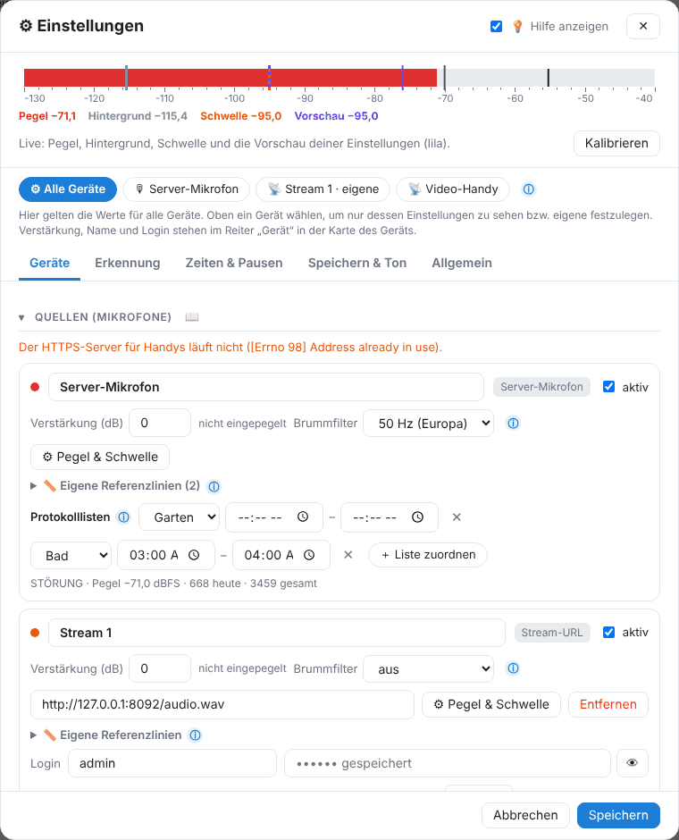

# Einstellungen von A bis Z

Ganz oben wählst du **Alle Geräte** oder ein einzelnes Gerät. Beim Gerät lassen sich mit „Eigene Einstellungen für dieses Gerät“ abweichende Werte festlegen (Schwelle, Mindestdauer, Aufnahmezeit, Speichern). Die Leiste oben zeigt live Pegel, Hintergrund, Schwelle und die **Vorschau** (lila) deiner noch nicht gespeicherten Einstellungen. ⓘ erklärt jede Einstellung; „Hilfe anzeigen“ blendet die Texte aus.

## Geräte

- **Quellen (Mikrofone)** – siehe [Geräte](06-geraete.md).
- **Geräte einpegeln** – siehe [Einpegeln](06-geraete.md#einpegeln).
- **Mikrofon** – Eingang am Server, Buchse, Lautstärke, Tonqualität (16000 Hz reicht für Klopfen).

## Erkennung

### Wann gilt etwas als Störung?

> **🔒 Pro:** Ohne Pro sind diese Werte nur zum Ansehen; GasLighter arbeitet mit den Standardwerten. Ändern lassen sie sich mit [GasLighter Pro](14-pro.md).

| Einstellung | Bedeutung |
|---|---|
| Art der Schwelle | **Passt sich an, mit Grenzen** (empfohlen), **Passt sich an**, **Fest** |
| Wie viel lauter als normal? | Abstand zum Hintergrund, 8–10 dB ist ein guter Start. Kleiner = empfindlicher. |
| Untergrenze / Obergrenze | Tiefer bzw. höher geht die Schwelle nie. |
| Feste Schwelle | nur bei „Fest“ |
| „Normal“ wird gelernt aus den letzten … | Zeitraum für den Hintergrund (z. B. 60 s) |
| So wird „normal“ berechnet | **Leiseste Momente** (empfohlen), typischer Pegel, Minimum, Durchschnitt, Maximum |
| Anpassung, wenn es lauter / leiser wird | Groß = Lärm zieht die Schwelle kaum mit; klein = folgt schnell |
| Mindestdauer (ms) | 0 = jeder Klopfer zählt; 40–60 filtert Knackser |

**Tonprofile** – siehe [KI](05-ki.md#tonprofile). **Andere Werte zu bestimmten Uhrzeiten** (Zeitprofile) – z. B. nachts empfindlicher, allgemein oder je Gerät.

## Zeiten & Pausen

- **Wann wird überwacht?** – Überwachen ab / bis (beide leer = rund um die Uhr, über Mitternacht möglich). Außerhalb davon wird nichts gezählt; über die Anzeige oben lässt sich trotzdem erfassen.
- **Home Assistant: pausieren oder festhalten** – siehe [Home Assistant](07-home-assistant.md#regeln).
- **Notizen & Protokoll** – Ruhezeit ab / bis (üblich 22:00–6:00), Sonntag ganztägig Ruhezeit. Notizen und Störungen in der Ruhezeit bekommen 🌙.

## Speichern & Ton

### Aufnahme der Störung

| Einstellung | Bedeutung |
|---|---|
| Umfeld (s) | so viele Sekunden vor und nach der Störung werden beim Ansehen gezeigt |
| … mit Ebenen | tief/mittel/hoch, Frequenz für den ganzen Tag (+1–2 MB pro Gerät und Tag) |
| … mit Spektrum | Spektrogramm für jeden Moment (+3–8 MB pro Gerät und Tag) |
| KI-Fingerabdruck durchgehend speichern | siehe [KI-Fingerabdruck](05-ki.md#fingerabdruck); darunter steht, ob er läuft |
| Alte Aufnahmen automatisch löschen / nach Tagen | aus = es wird nie etwas gelöscht |

### Echten Ton speichern (nicht empfohlen)

Standard **aus**. Eingeschaltet wird zu jeder Störung zusätzlich eine WAV-Datei gespeichert. **Ton nur ohne erkannte Stimmen** (empfohlen) verhindert das Speichern, sobald die KI irgendwo Stimmen erkennt. Lies vorher [Rechtliches](12-rechtliches.md).

### Video & Speicherort

Ordner für Lärmspuren, Video-Breite, Bilder pro Sekunde, Videoqualität.

## Allgemein

- **Allgemein** – Geräuschart erkennen (lokale KI), KI-Fingerabdruck speichern, Gruppe: höchste Pause, Notiz zuordnen, Sprache.
- **Sicherung der ganzen App** – siehe [Sicherung](09-sicherung.md).
- **Zurücksetzen** – siehe [Zurücksetzen](09-sicherung.md#zuruecksetzen).
- **Diagnose** – Angaben zu Mikrofon und Soundkarte für die Fehlersuche.

---
[← Unterbrechungen, Datenkette und Updates](10-unterbrechungen.md) · [Inhalt](README.md) · [Rechtliches und Datenschutz →](12-rechtliches.md)
