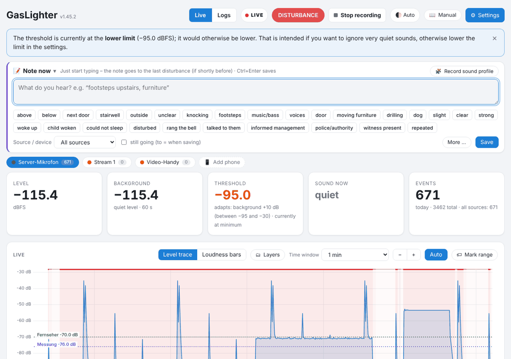

# Quick start in 5 minutes

GLighter listens continuously and writes a **noise log**: when it was how loud, for how long and what kind of sound – with checksums so nobody can change the data unnoticed. **No sound is stored**, only measurements.

## 1. Connect a microphone

- Plug a USB microphone (or one on the sound card) into the Home Assistant computer. The entry “Server microphone” already exists.
- More rooms: add phones as microphones, see [Devices](06-geraete.md).
- If the **Level** tile shows a value and the curve moves when you knock, sound arrives. If the blue note “The signal is very quiet” appears, raise the microphone volume (⚙ Settings → Devices → Microphone) or pick the right input.

## 2. Check the threshold

A **disturbance** is counted when the level rises above the **threshold** (orange dashed line). Default: “Adapts, with limits” – the threshold sits 10 dB above the normal background, but never below −95 and never above −30 dBFS.

- A loud knock should clearly cross the line and be marked red.
- Too many small things counted: raise “How much louder than normal?” (e.g. 12 dB). Too few: lower it.
- Details: [Settings → Detection](11-einstellungen.md#erkennung).

> **Tip:** Levels are **dBFS** – relative to the sound card, therefore negative (−80 very quiet, −20 very loud). What matters is the distance to the background, not the absolute value. See [Glossary](15-glossar.md).

## 3. Level-match several microphones (optional)

To compare devices: ⚙ Settings → Devices → **Level-match devices**. Put all microphones side by side, 5 s of quiet, then a steady sound. Afterwards all devices show the same value for the same sound.

## 4. Look at the first disturbance

- In the **Live** tab, “Events today” is at the bottom. A click opens the disturbance with chart, spectrogram and detected type.
- The **Logs** tab shows whole days and weeks, the history of all devices below each other and the list of all disturbances.
- Write down what you hear right now under **📝 Note now** (“steps upstairs”, “bass”) – the note is attached to the last disturbance automatically.

## 5. Backups and updates

- Regularly download a backup under ⚙ Settings → Storage & backup → **Download backup**. See [Backup](09-sicherung.md).
- Updates without a recording gap: copy the new folder to `\\homeassistant\share\gaslighter_update\`. See [Updates](10-unterbrechungen.md#updates).

> **Important:** GLighter is a memory aid and documentation, not a calibrated dB(A) measurement. For landlords, property managers or authorities what counts most is: regular, traceable, with your own notes. See [Noise log](08-drucken.md#laermprotokoll).

---
[Contents](README.md) · [Live view →](02-live.md)
