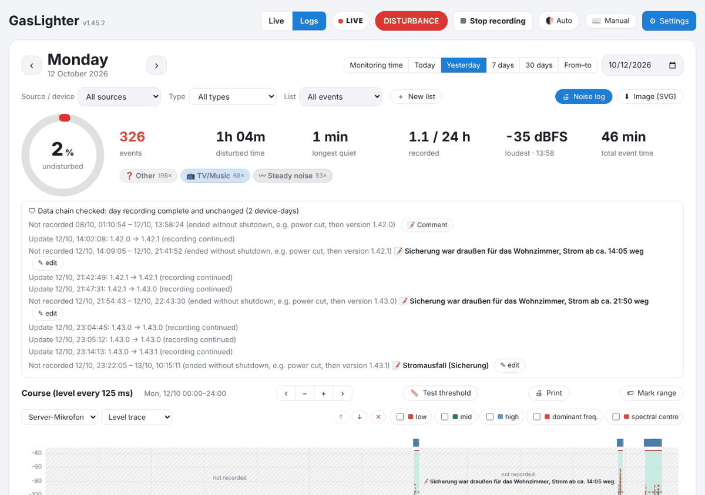
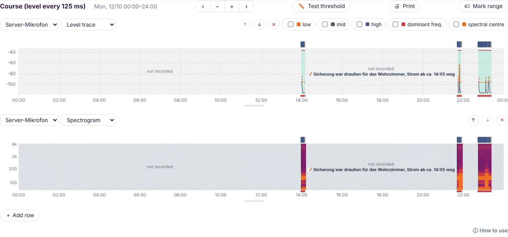
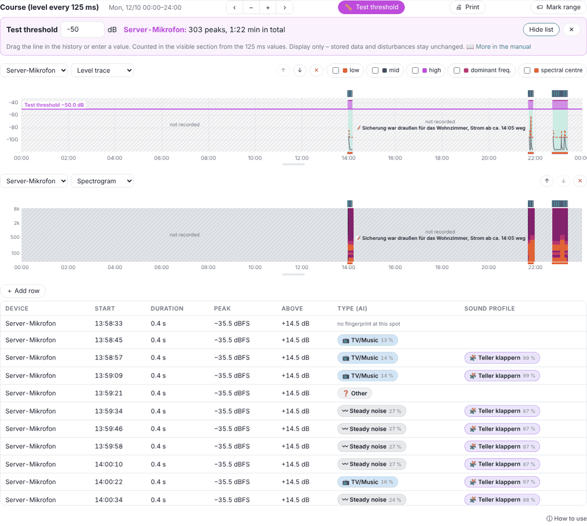
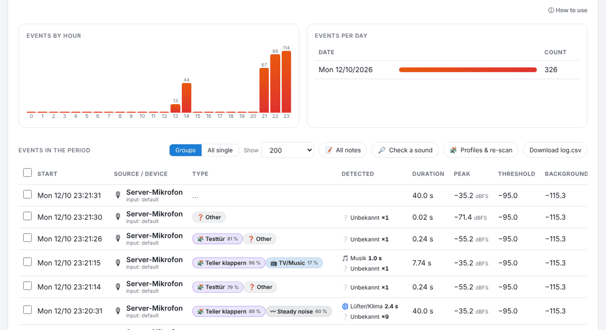

# Logs

The **Logs** tab shows a period completely: summary, week strip, history of all devices, statistics and the list of all disturbances.

## Period and filters

- **Monitoring time** (the set monitoring hours, e.g. 22–6), **Today**, **Yesterday**, **7 days**, **30 days** or **From–to**. ‹ › moves by a whole period.
- **Source / device**, **Type** (e.g. knocking only) and **List** filter everything below. Devices that no longer exist but still have data are listed as “(former)”.
- **🖨 Noise log** creates the noise log for period, device and list, **⬇ Image (SVG)** an image. See [Printing](08-drucken.md).

## Summary and week strip

The ring shows how much of the time was **undisturbed**. Next to it: number of disturbances, disturbed time, longest quiet, recorded time and the loudest event.

The **circles** below are the last 7 nights or days. Tap to choose a day; the newest one always stays visible. Below are the **data chain** (checksums) and interruptions, see [Interruptions](10-unterbrechungen.md).

## History

The history shows the devices below each other for the same period. Per row choose **device** and **display** (level trace, loudness bars, spectrogram) and toggle layers. “＋ Add row”, ↑ ↓ ✕ arrange the rows; the handle below each row changes its height.

- While the day is still running the time axis ends at **now** – the newest data is on the right and the history grows every minute.
- With more than 2 days it shows minute values, zooming in brings back the 125 ms values.
- At the top the AI marks the detected type of each disturbance in its colour; **blue** = on according to Home Assistant (e.g. TV).
- **Hatched** = not recorded (e.g. power cut). Click it to add a comment, see [Interruptions](10-unterbrechungen.md#kommentar).

Controls as in the live view: wheel/two fingers zoom, drag a range, when zoomed drag or ‹ › to move, Shift + wheel for the height, double click or “Whole period” for everything. On a phone, test threshold, print and mark range are under **⋯ Tools**, the layers behind **🗂 Layers**.

## 📏 Test threshold

With the test threshold you check afterwards which peaks were above a freely chosen value – e.g. “How often was it above −50 dB?”

1. Tap “📏 Test threshold”, enter a value or drag the purple line in the history.
2. Per device you see number and duration of the peaks in the visible section (from the 125 ms values; less than 0.5 s apart = one peak).
3. “List of peaks” shows each peak with time, duration, height, distance, **Type (AI)** and **Sound profile**. A click jumps there in the history.

The type comes from the disturbance if the peak lies in one, otherwise from the stored **AI fingerprint** (ⓕ). Possible notes: “no fingerprint at this spot”, “no AI fingerprint on this day”, “not checked” (more than 2000 peaks). See [AI](05-ki.md#fingerabdruck).

> The test threshold is **display only**. Stored data, disturbances and checksums stay unchanged. It is printed along when printing.

## Events in the period

- **Groups** combines disturbances of the same type (at most “Group: max. pause” apart), **All single** shows each.
- **Sorting:** click a column header (start, duration, peak, threshold, background); click again to reverse. The sort order is remembered in the browser.
- **Filter with multiple choice:** under **Source / device** and **Type** click one or more entries, e.g. only “door sensor vibration” and “voice”. The line above the table counts disturbances and sensor events separately.
- **Sensor events** (Home Assistant rule “as event”, phone as motion sensor) are sorted in by time with an orange edge; ✎ = note.
- On narrow screens ⊕ at the start of a row expands the remaining columns.
- Click = jump there in the history, double click or ▶ = [open the event](04-ereignis.md), ⋮ = more actions (download noise track, re-evaluate, delete).
- Select, then **Add to list** or delete. Deleted entries are kept in a recycle bin for safety; the day recording stays.
- **📝 All notes**, **🔎 Check a sound** (analyse your own audio file, not stored), **🧩 Profiles & re-scan**, **Download log.csv**.

## Log lists

Your own lists such as “bathroom” or “garden” collect disturbances in addition to the full list – by hand (“Add to list”, or in the event under “Lists”) or automatically per device and time (⚙ Settings → Devices → device card → **Log lists**). Each list has its own note and its own noise log.

---
[← Live view](02-live.md) · [Contents](README.md) · [Event window →](04-ereignis.md)
