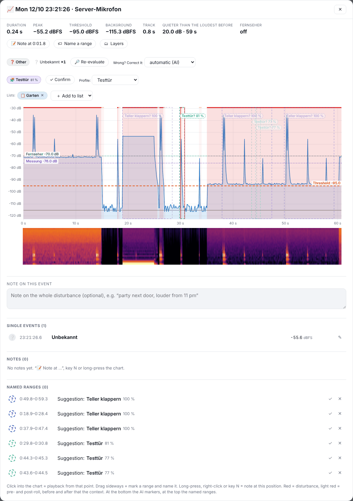

# Event window

Double-clicking a disturbance opens all details.

## Key figures

Duration, peak, threshold, background, track (period shown) and:

- **Above the loudest before** or **Quieter than the loudest before** – distance of the peak to the loudest level of the time before (disturbances not counted). Shows that the disturbance was louder than e.g. a running TV.
- States from Home Assistant (e.g. “TV: off”, volume), see [Home Assistant](07-home-assistant.md).

## Chart

- **Red** = the disturbance, **red lines** = start and end, light red = pre- and post-roll.
- **Dashed boxes** = suggestions from your sound profiles (“dishes clattering? 100 %”). Suggestions outside the disturbance are paler. Tap: ✓ Correct / ✕ Wrong.
- Below, the **spectrogram**; with several devices the **device comparison** (peak per device, distance to the loudest).
- **▶ Show playback** runs a pointer across it in real time (no sound).

## Type, profile and lists

- **Type (AI)** with confidence in %. “Wrong? Correct it” sets the type by hand – your correction wins. **🔎 Re-evaluate** analyses again (needs the stored AI fingerprint).
- **🧩 Profile**: the most similar sound profile. **✓ Confirm** or choose another – both become a new learning example.
- **Lists**: add the disturbance to a log list or remove it.

## Notes and named ranges

- **📝 Note at …** (or key <kbd>N</kbd>, long press on the chart) adds a note at exactly this point, with quick tags and witness.
- **🏷 Name a range**: drag horizontally in the chart and choose a name. See [AI → Learning](05-ki.md#lernen).
- **Note on this event**: a free text field per disturbance, saved automatically.

---
[← Logs](03-protokolle.md) · [Contents](README.md) · [AI: sound types and sound profiles →](05-ki.md)
