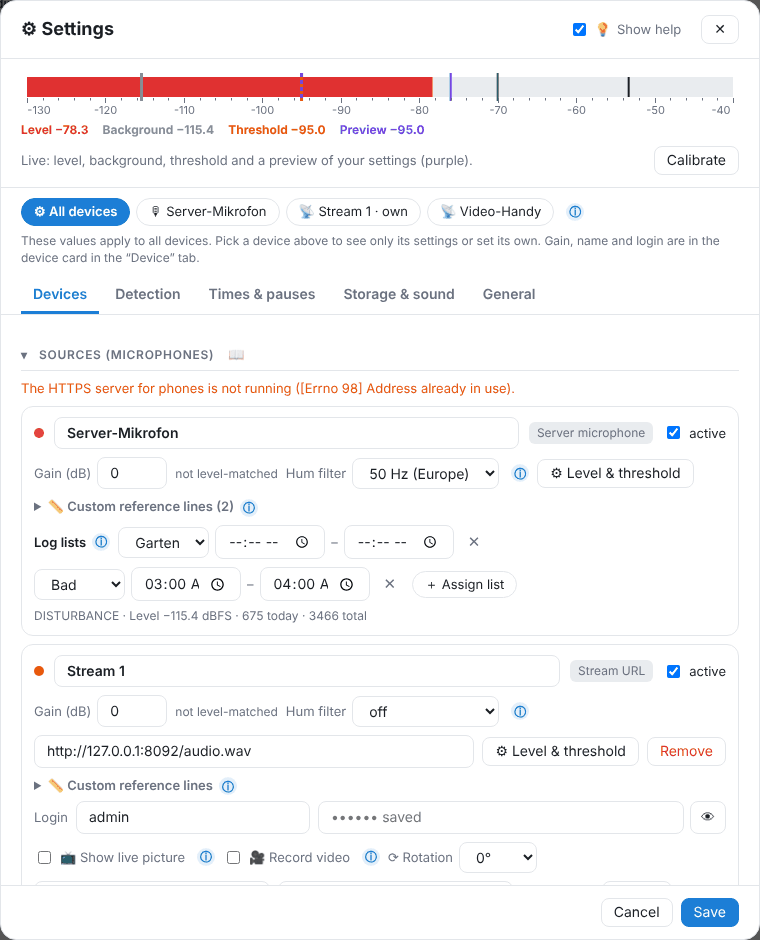
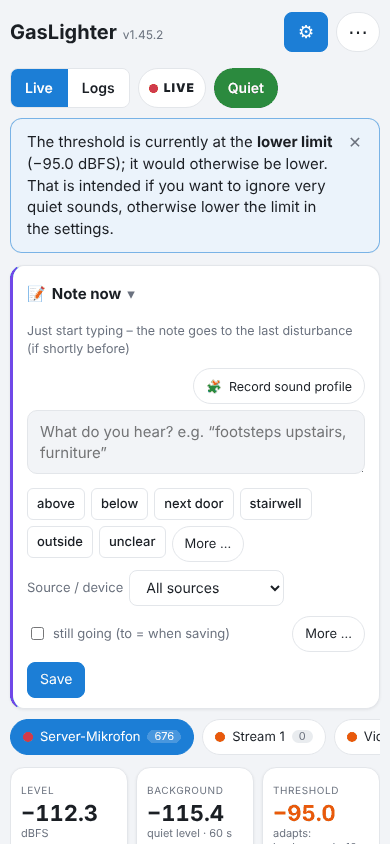

# Devices

All microphones are under ⚙ Settings → **Devices** → Sources. Up to 9 devices are possible.

## Server microphone

The microphone on the Home Assistant computer. Under **Microphone** you choose input, jack and volume. Usually leave it on “Default”. The **hum filter** (50 Hz in Europe) removes mains hum.

## Phone as a microphone

> **🔒 Pro:** phones, stream URLs and IP cameras are external devices and part of [GLighter Pro](14-pro.md). The server microphone is always free.

- **Phone (browser)**: “+ Phone (browser)”, scan the QR code, open the page in Chrome, accept the certificate warning, **Start**. The screen must stay on (charger). The link is secret and belongs to this phone only.
- **Stream (e.g. the app “IP Webcam”)**: “+ Phone app / stream URL”, address `http://PHONE-IP:8080/audio.wav`. Also works with the screen off. With a login: user name and password in their own fields.
- The phone port is **18443** by default (add-on → Network, “8443/tcp”).

### Video

For streams you can switch on **🎥 Record video**: on a disturbance an mp4 file **without sound** is created. Nothing is stored without a disturbance. Quality under Storage & backup → Video, folder under Storage location.

> Camera recordings in homes can be problematic (§ 201a StGB in Germany) – only film your own rooms and no other people.

## Phone as a motion sensor

A phone set up as a device can additionally act as a **motion sensor** – like a motion or vibration sensor in Home Assistant:

- **🫨 Vibration** (accelerometer): the phone lies flat on the floor, a table or against the wall and reports vibrations – e.g. stomping, bass coming through the ceiling, slamming doors or moving furniture. This documents structure-borne noise you feel, not just hear.
- **🏃 Motion in the camera picture**: the phone camera detects motion in the picture (e.g. in the stairwell). Sudden brightness changes (light on/off) are compensated.
- **📐 Tilt**: after starting, the phone remembers its rest position and reports when it is moved, tipped or lifted (sensitivity high/medium/low ≈ 3°/6°/12°). If it lies still in a new position for 1 minute, that becomes the new rest position.

**Switch on:** ⚙ Settings → Devices → card of the phone → **Phone as motion sensor** → tick "Vibration" and/or "Motion in camera picture", choose the **sensitivity** (high, medium, low). Then reload the page on the phone and tap **Start**. The browser asks for the camera or (iPhone) for "motion and orientation".

### With the IP Webcam app

If the phone is connected via **“+ Phone app / stream URL”** with the Android app **IP Webcam**, GLighter reads the app’s sensors (`http://PHONE:8080/sensors.json`; a login in the address is used too). On the device card the box is called **“IP Webcam: read phone sensors”**, with the same switches (vibration, tilt, motion in camera picture) and the same sensitivity.

- **Vibration and tilt** come from the phone’s accelerometer – the sensors must be switched on in IP Webcam.
- **Motion in camera picture** uses IP Webcam’s **motion detection** – switch it on in the app.
- If something is missing or the app is unreachable, the card says what to switch on.

> **Privacy:** everything is evaluated on the phone. Only numbers are sent (vibration strength, share of changed pixels) – **no picture and no video**. The preview is only visible on the phone itself.

**What you get:**
- On the phone and in the device bar 🫨 or 🏃 blinks while triggered.
- Each vibration or motion is stored with start, end and peak (`bewegung.csv` in the data folder). It counts as "on" until 20 s after the last trigger.
- The **Reports** tab lists "Vibration and motion in the period"; a click shows the spot in the history. The [noise report](08-drucken.md) contains its own table.
- In **Home Assistant** each phone gets a "Vibration" or "Motion" sensor – usable in automations and in the [rules](07-home-assistant.md#regeln), e.g. "only record state", so it appears with every disturbance and in the daily chart.

Part of the external devices and therefore of [GLighter Pro](14-pro.md).

## Device card

- **Name**, **active**, **gain (dB)** and hum filter.
- **⏺ Record only (no detection)**: the level is still stored in the day recording (with checksum chain, visible live, in the history and in the noise log chart). But this device creates no disturbances, no AI classification, no noise trace and no report to Home Assistant. The tile shows “⏺ record only”. When you switch detection back on it applies from then on; earlier times can be evaluated with “Re-examine”.
- **⚙ Level & threshold**: own settings for this device only.
- **📏 Own reference lines**: e.g. “TV −70 dB”, shown in all charts of this device.
- **Log lists**: assign disturbances of this device to a list automatically, optionally only at certain times.
- Devices taken over from a [backup](09-sicherung.md) that were not reachable are switched off and marked “please check”.

## Level-match devices

So that levels of different devices are comparable:

1. Put all microphones side by side, about the same distance (approx. 1 m) from the speaker.
2. **Level-match devices** → tick the devices to measure (at least two).
3. Choose the **test sound**: **play here** (through the PC or phone where the settings are open; check the volume with **▶ Preview**), **play on phone X** (a connected phone plays the noise and therefore does not measure itself) or **own sound** (extractor hood, hair dryer …).
4. **Start measurement**: the steps **1 Quiet → 2 Sound → 3 Result** are shown large, below them the level of each device – so you see right away whether every device hears the sound. The test sound starts and stops by itself.
5. Check the result: if a device is too quiet or unsteady, it says what to do (e.g. “move closer to the speaker”). Then **Apply and record**.

Each device gets its own gain so that all show the same value for the same sound. Every measurement is recorded and listed in the noise log. If the gain is changed by hand later, the device shows “⚠ changed since level-matching”; if level-matching is more than 3 months old, doing it again is recommended.

## Comparing rooms

When one device triggers, all others store the same period too (“On a disturbance store all devices”). In the event window **Device comparison** shows the peak per device. A TV in the living room is loudest there and has many highs; knocking through ceiling and walls is similar and low in all rooms.

---
[← AI: sound types and sound profiles](05-ki.md) · [Contents](README.md) · [Home Assistant →](07-home-assistant.md)
