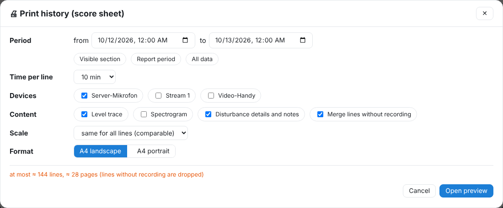
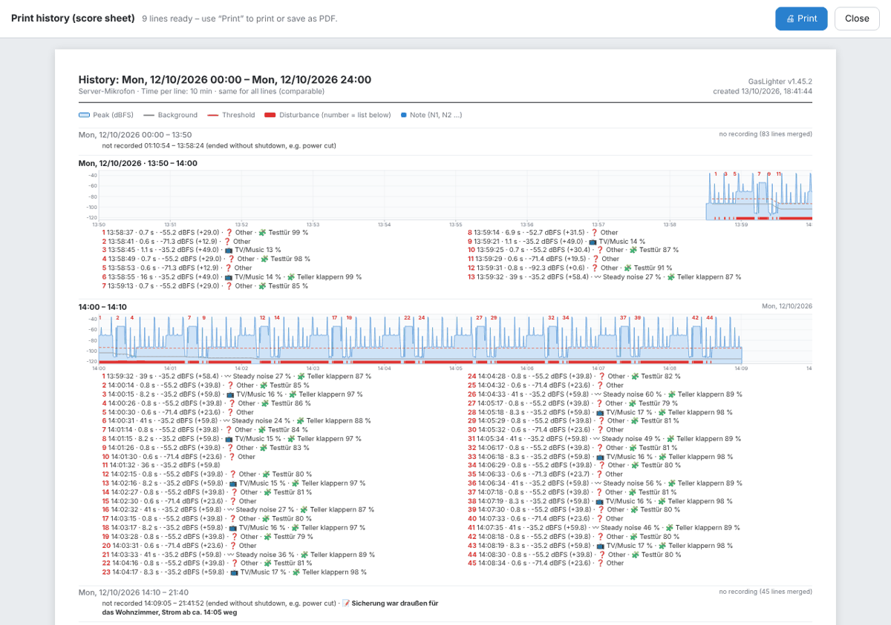

# Printing and noise log

There are two printouts: the **noise log** (report with summary and list) and the **history as a score sheet** (the curves line by line).

## Noise log

Logs tab → **🖨 Noise log** (for period, device and list) or **📝 All notes** → log. It contains:

- period, devices, summary (count, disturbed time, longest quiet), detected sound types, named ranges,
- the **day history**: one chart per day and device over 24 h (peak, background, threshold, disturbances red, Home Assistant blue, not recorded hatched, notes), same scale per device,
- every disturbance with date, time, duration, level, type, notes, witnesses and states from Home Assistant,
- quiet hours (🌙), countermeasures, level-matching of the devices,
- **interruptions and updates** with cause and your comment,
- the **data chain** per device and day with checksum.
- the **method**: program and version, per device type, microphone/model, place and window, “Microphone not calibrated: values are indications and do not replace an expert report”, whether sound is stored (“No audio is stored” while “Store real audio” is off) and that the sound type is a suggestion of the detection unless you confirmed it,
- a **summary** by time (hours, weekdays, quiet hours), type, intensity (peak), duration and frequency (on how many days, average per day),
- per disturbance **peak, duration and number of impulses** (how often the level rose above the threshold, from the day recording),
- a **gap-free timeline**: every day of the period, including days without disturbance, with “recorded” or “no recording”,
- a short **explanation of the checking procedure** for the data chain.

At the top of the page there is also **⬇ Raw data (CSV)** (all measured values of the disturbances, for experts) and **⬇ Evidence package (ZIP)**: noise log (HTML), raw data, notes, timeline and checksums as CSV and a summary with method as text. Both are also available under 📝 All notes → log.

**Pattern filter:** by default all disturbances are included; those filtered out by a [pattern](11-einstellungen.md#muster) carry the note “filtered out by pattern …”. With **leave out those filtered by pattern** they are omitted and the top names the patterns and how many they removed.

At the top of the page (not printed) choose **Day chart** (on by default) and **Chart per disturbance** (off by default): a small chart with context below every disturbance that has a note or comes from the chosen list (at most 300).

Print in the browser or save as PDF. The printed document is always titled “Lärmprotokoll” (noise log).

> Levels are relative dBFS values, not a calibrated dB(A) measurement. Sound recordings never go into the log. Not legal advice.

## Print history (score sheet)

In the history **🖨 Print**:

- **Period**: from–to or quick choice “Visible section”, “Period of the report”, “All data”.
- **Time per line**: 1 min to 1 h (default 10 min – a whole day is 144 lines).
- **Devices** below each other, **content** (level trace, spectrogram, disturbance info and notes), **Merge lines without recording** (on by default).
- **Scale**: the same for all lines (comparable) or fitted per line (more detail); **A4 landscape** or **portrait**.
- **Evidence (summary, timeline, checksums)** (on by default): a summary by time, type, intensity, duration and frequency at the top; method, timeline with all days, checksums with explanation and the link to the raw data (CSV) at the bottom. Each disturbance shows its impulses and, unless confirmed, “suggestion of the detection (confidence x %)”.
- **leave out those filtered by pattern**: as in the noise log.

The dialog estimates lines and pages. **Open preview** builds the pages in a new window; print there or save as PDF. An active [test threshold](03-protokolle.md#pruefschwelle) is printed along, with a count per line.

---
[← Home Assistant](07-home-assistant.md) · [Contents](README.md) · [Backup, import and export →](09-sicherung.md)
