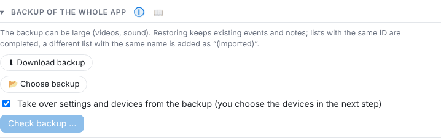

# Backup, import and export

## Download a backup

⚙ Settings → General → **Backup of the whole app** → **⬇ Download backup**. The ZIP file contains everything: settings, devices, time profiles, rules, `log.csv` and all log files, day recordings with checksums, AI results, sound profiles, notes, comments on interruptions, named ranges, lists, videos and – if stored – sound.

> The file can get large (hundreds of MB). Download it regularly and keep it in another place.

For further processing there are also `log.csv` (Logs tab), the notes as CSV (📝 All notes) and the noise log as PDF.

## Restore a backup

> **🔒 Pro:** the first import is free (e.g. when moving), further imports are part of [GasLighter Pro](14-pro.md#umzug). Downloading a backup is always free.

1. **📂 Choose backup** and **Check backup …** – the file is uploaded and examined, nothing is changed yet.
2. The preview shows version and date of the backup and – with “Take over settings and devices” – every device from the backup:
   - **already here** (will be replaced) or **new**,
   - **ready**, **phone** (connects as soon as it opens the app) or **not reachable** (taken over switched off, marked “please check”).
   - Devices set up only here **stay unchanged**.
   - If the backup's microphone does not exist here, the current one stays selected.
3. Set or clear the ticks and **Restore now**.

Afterwards a report shows new files, merged days, skipped days and the devices taken over.

### What happens when restoring

- **Nothing twice, nothing overwritten**: existing disturbances, notes and lists stay, only missing data is added. Restoring several times does no harm.
- **Days that already exist** (e.g. “today” after a reinstall): the missing minutes are added. The checksum chain stays verifiable – the restored part gets its own section, and “Interruptions” lists “Import …: extended by N minutes”. If the times overlap with other data, the day is skipped and named in the report.
- **Devices that no longer exist**: their data is still restored and can be chosen as “(former)” in the history, the device filter and printing.
- Storage locations (output and clip folder) stay those of this system.

## Reset

⚙ → General → **Reset**: measurements & disturbances, notes & lists, sound profiles or settings to default. Devices and connections always stay. A backup is offered first.

## Search index

GasLighter keeps a **search index** (SQLite file `suchindex.sqlite` in the app data folder). It speeds up noise reports over weeks and months:

- **Chain check per day:** the result is stored with a SHA-256 checksum over the *content* of all files of that day. If a single byte changes, the day is checked again – the check is exactly as strict as without the index.
- **Condensed day tracks** (every 10 seconds) for the charts in the noise report.

The index only contains derived data, never changes the recording, checksum chain or disturbances, is not part of the backup and fills slowly in the background after start. **Settings → General → Backup → Rebuild** clears it; it then rebuilds itself. If it is missing or damaged, GasLighter works without it – just slower.

---
[← Printing and noise log](08-drucken.md) · [Contents](README.md) · [Interruptions, data chain and updates →](10-unterbrechungen.md)
