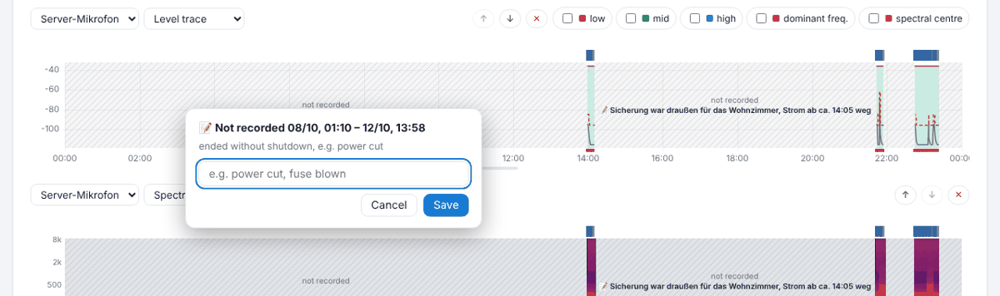

# Interruptions, data chain and updates

## Interruptions

If the add-on is not running (power cut, Home Assistant restarted, update via the add-on store), the recording is missing. GasLighter notices this at the next start and shows it in Logs below the summary:

- **ended without shutdown, e.g. power cut** – the add-on could not sign off (power gone, crash).
- **stopped / restarted by Home Assistant** – ended cleanly (restart, add-on stopped).
- **Update** – a new version was installed.
- **Gap in the day recording, cause not logged** – more than 90 seconds are missing in the data without the start noticing (e.g. moving to a new installation). Applies to the microphone on the computer and streams; deliberate pauses do not count, phones are not checked.

After a power cut Home Assistant starts the add-on by itself as soon as the computer runs again.

## Add a comment

- In the **history**, click or tap the hatched area – a small window with period and cause opens. Enter text, e.g. “fuse blown”, **Save**.
- Or in the list “Not recorded …” on **📝 Comment**.

The comment appears in the hatching, the list, the printout and the noise log. The recording itself stays unchanged.

## Watchdog

On the add-on page in Home Assistant switch on **Watchdog**: if the add-on stops unexpectedly, Home Assistant restarts it.

## Data chain (checksums)

Every written minute of the day recording gets a SHA-256 checksum built on the previous one. If someone later changes a value or removes a minute, the chain no longer matches from that point.

- Logs shows “🛡 Data chain checked: complete and unchanged” or where it differs.
- The noise log lists the result and the last checksum per device and day.
- Each device reports its checksum to Home Assistant every hour (stored there independently).
- Days completed from a backup have their own section in the chain, see [Backup](09-sicherung.md#zusammenfuehren).

## Updates

**Without a recording gap:** copy the folder `gaslighter` from the update zip via Samba to `\\homeassistant\share\gaslighter_update\` (overwrite existing files). After 10–20 s only the program restarts; recording continues and is delivered afterwards. If the new version does not start, the add-on automatically goes back to the previous one.

**Full installation** (only when a version requires it, e.g. new name or watchdog): copy the folder from the full zip to `\\homeassistant\addons\` and rebuild the add-on in Home Assistant. This causes a short gap.

Every start, update and interruption is listed with time and version in Logs and in the noise log.

---
[← Backup, import and export](09-sicherung.md) · [Contents](README.md) · [Settings from A to Z →](11-einstellungen.md)
