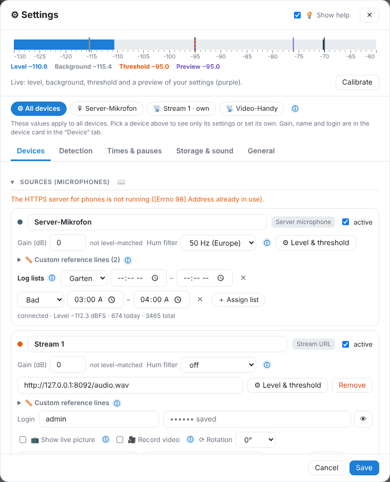

# Settings from A to Z

At the very top choose **All devices** or a single device. For a device, “Own settings for this device” sets different values (threshold, minimum duration, monitoring time, storage). The bar at the top shows level, background, threshold and the **preview** (purple) of your not yet saved settings live. ⓘ explains every setting; “Show help” hides the texts.

## Devices

- **Sources (microphones)** – see [Devices](06-geraete.md).
- **Level-match devices** – see [Level-matching](06-geraete.md#einpegeln).
- **Microphone** – input on the server, jack, volume, sound quality (16000 Hz is enough for knocking).

## Detection

### When does something count as a disturbance?

> **🔒 Pro:** without Pro these values are view only and GasLighter uses the defaults. They can be changed with [GasLighter Pro](14-pro.md).

| Setting | Meaning |
|---|---|
| Type of threshold | **Adapts, with limits** (recommended), **Adapts**, **Fixed** |
| How much louder than normal? | distance to the background, 8–10 dB is a good start. Smaller = more sensitive. |
| Lower / upper limit | the threshold never goes below or above |
| Fixed threshold | only with “Fixed” |
| “Normal” is learned from the last … | period for the background (e.g. 60 s) |
| How “normal” is calculated | **Quietest moments** (recommended), typical level, minimum, average, maximum |
| Adapting when it gets louder / quieter | large = noise hardly pulls the threshold along; small = follows quickly |
| Minimum duration (ms) | 0 = every knock counts; 40–60 filters clicks |

### Recognize sound type (AI)

**Recognize sound type (local AI)** – classifies disturbances (door, knocking, music …), no sound is stored. **Store AI fingerprint for each disturbance** – better distinction when learning and “re-evaluate” without sound. **Also store AI fingerprint between disturbances** – continuously, for “re-examine”; see [AI fingerprint](05-ki.md#fingerabdruck).

**Sound profiles** – see [AI](05-ki.md#tonprofile). **Different values at certain times** (time profiles) – e.g. more sensitive at night, general or per device.

## Times & pauses

- **When to monitor?** – monitor from / to (both empty = around the clock, past midnight possible). Outside of it nothing is counted; you can still capture via the display at the top.
- **Quiet hours** – quiet hours from / to (usually 22:00–6:00), Sunday all day. Notes and disturbances during quiet hours get 🌙.
- **Different values at certain times** – see above (time profiles).
- **Home Assistant: pause or record state** – see [Home Assistant](07-home-assistant.md#regeln).

## Storage & backup

### What is stored?

| Setting | Meaning |
|---|---|
| Context before and after the disturbance (s) | this many seconds before and after the disturbance are shown when viewing |
| Day recording with layers | low/mid/high, frequency for the whole day (+1–2 MB per device and day) |
| Day recording with spectrum | spectrogram for every moment (+3–8 MB per device and day) |
| Record all devices on a disturbance | the other devices store a noise track for the same period (no sound) – to compare rooms |

### Store real audio (not recommended)

Default **off**. When on, a WAV file is stored for each disturbance in addition. **Audio only without detected voices** (recommended) prevents storing as soon as the AI detects voices anywhere. Read [Legal](12-rechtliches.md) first.

### Video

Video width, frames per second, video quality (for IP cameras and phones).

### Storage location

**Folder for noise tracks** – empty = default. Only change it if new noise tracks should be stored elsewhere (e.g. `/media/gaslighter`). For a copy on the NAS use the **daily backup**, not this folder.

### Keep & delete automatically

**Delete old recordings automatically** and **Delete after (days)** – off = nothing is ever deleted. With the daily backup, only what is verified in the target is deleted.

### Backup

**Download / restore backup (ZIP)** – always free. **Daily backup** to network drive, NAS or USB (Pro). Both see [Backup](09-sicherung.md).

## General

- **Language** – German, English or like the browser.
- **Log & notes** – **Group disturbances up to (s) apart** (groups in the list), **Note belongs to the disturbance if up to (min) after it**.
- **GasLighter Pro** – see [Pro](14-pro.md).
- **Reset** – see [Reset](09-sicherung.md#zuruecksetzen).
- **Diagnostics** – details about microphone and sound card for troubleshooting.

---
[← Interruptions, data chain and updates](10-unterbrechungen.md) · [Contents](README.md) · [Legal and privacy →](12-rechtliches.md)
